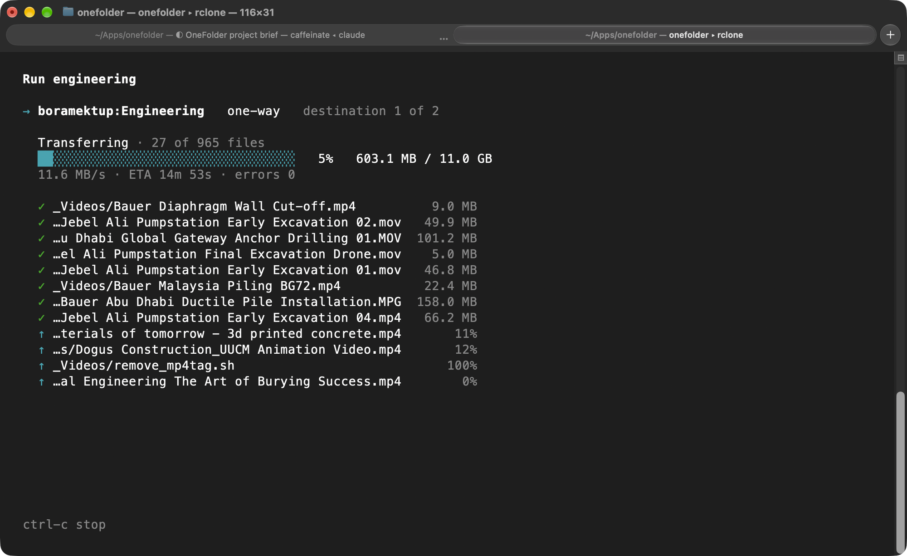

<div align="center">
  <h1>OneFolder</h1>
  <p><b>Keep local folders in sync with OneDrive accounts and external drives, one-way or two-way, from a calm terminal app for macOS, Linux and Windows (WSL).</b></p>
  <a href="https://github.com/boraoku/onefolder/releases"></a>
  <a href="https://github.com/boraoku/onefolder/releases"></a>
  <a href="LICENSE"></a>
  <a href="https://github.com/boraoku/onefolder/commits"></a>
</div>

<p align="center">
  
</p>

OneFolder keeps local folders in sync with OneDrive accounts and external drives. It is a single terminal program for macOS, Linux and Windows (through WSL) that drives [rclone](https://rclone.org) to do the copying, and adds the parts that make a sync safe to run every day: a preview before anything changes, a check that an external drive really is the drive you set up, a question before a deleted folder is deleted on the other side, and a log of every run.

Each job has one local source folder and one or more destinations. Each destination is either a folder on a OneDrive account or a local folder (usually on an external drive), and each one is synced either one-way or two-way.

## Features

- **OneDrive and external drives**: Each job syncs one local folder to any mix of OneDrive folders (personal or business accounts) and local folders on external drives
- **One-way or two-way**: One-way copies new and changed files and never deletes; two-way keeps both sides the same with `rclone bisync`
- **Moves, not duplicates**: When you move or rename files or folders on your computer, a one-way run notices and offers to move them on the destination instead of uploading them again, so a moved file is not sent twice or left behind under its old name. Where OneFolder cannot tell which file moved (identical copies it cannot tell apart, or empty files), it uploads as before and the old copy stays
- **Calm terminal interface**: A Mole-style menu with arrow and vim keys, plus scriptable subcommands with `--dry-run`, `--yes` and `--json`
- **Folder-deletion prompt**: When a folder disappears from your computer, OneFolder asks whether to delete it on the destination, keep it there, or restore it
- **Conflicts never lose data**: The local copy wins and the other is kept as a `.conflict` copy; every conflict is listed, and run logs are kept until you prune them
- **Volume identity checks**: Before each run OneFolder proves an external drive is the one you set up, so an unplugged drive is never mistaken for an empty folder
- **No system clutter**: `.DS_Store`, `._*` resource forks, `Thumbs.db`, `desktop.ini` and other files macOS and Windows make for themselves are never synced; hidden files are left out too unless a job turns on "Copy hidden files"
- **Visible progress from the start**: While the preview of a large folder runs, the screen counts the files checked and to be copied, so a long listing never looks stuck; the transfer that follows shows its full totals from its first second
- **Leaves the heavy lifting to rclone**: OneFolder never calls the Microsoft Graph API itself, stores no tokens, and never installs, updates or downloads rclone

## Quick Start

OneFolder runs on macOS (Apple silicon or Intel), on Linux (x86_64 or ARM64, with glibc 2.35 or newer: Ubuntu 22.04, Debian 12, Fedora 36 and later; RHEL, Rocky and Alma 9 and Debian 11 are older, so build from source there) and on Windows through WSL (WSL 2, or WSL 1), and needs rclone 1.66 or newer on your `PATH`. Drive checks on Linux need util-linux's `lsblk` 2.33 or newer (it lacks the `PATH` column before that, as on Rocky 8). On a Mac, install rclone with Homebrew (`brew install rclone`); on Linux and WSL, with rclone's own installer from [rclone.org/install](https://rclone.org/install/) (`sudo -v ; curl https://rclone.org/install.sh | sudo bash`), or with Homebrew if you use it there. Your distribution's package may be older than 1.66. The Homebrew formula below installs rclone along with OneFolder. OneFolder itself never installs, updates or downloads rclone. If rclone is missing or too old, every command that needs it says so and exits with code 2.

**Install via Homebrew**

```bash
brew install boraoku/apps/onefolder
```

This taps `boraoku/homebrew-apps` and installs the `onefolder` binary built for your processor (Apple silicon or Intel on a Mac; x86_64 or ARM64 on Linux, where it works with [Homebrew on Linux](https://docs.brew.sh/Homebrew-on-Linux) too). `brew upgrade onefolder` picks up new releases.

**Or via script**

Each GitHub release also carries a shell installer, for macOS, Linux and WSL. It puts `onefolder` in `~/.cargo/bin`; on Linux without Homebrew, install rclone from [rclone.org](https://rclone.org/install/) first.

```bash
curl --proto '=https' --tlsv1.2 -LsSf https://github.com/boraoku/onefolder/releases/latest/download/onefolder-installer.sh | sh
```

**Run**

```bash
onefolder                                  # Main menu
onefolder accounts                         # Accounts list (on a terminal)
onefolder accounts add work                # Add a OneDrive account; rclone opens the browser to sign in
onefolder accounts list                    # Accounts, drive type and whether delta listing is on
onefolder accounts test                    # Check every account can still reach OneDrive
onefolder accounts reconnect work          # Sign in again when a token has expired
onefolder accounts remove work             # Remove an account and its rclone remote
onefolder jobs                             # Jobs list (on a terminal)
onefolder jobs add documents               # Add a job with the form, or from flags
onefolder jobs edit documents              # Edit a job with the form, or from flags
onefolder jobs list                        # Print jobs and their destinations
onefolder jobs remove documents            # Remove a job; its files and run logs stay
onefolder jobs release documents FOLDER    # Start syncing a held folder again
onefolder run documents                    # Run every destination of a job, in order
onefolder run documents --dest d-7f3a      # Run one destination only (ids are in jobs list --json)
onefolder run documents photos             # Run several jobs, one after another, in config order
onefolder run --all                        # Run every job, one after another
onefolder status                           # The last run of every destination
onefolder doctor                           # Check rclone, accounts, jobs, drives and data files
onefolder doctor --prune-logs              # Remove old run logs
onefolder completion zsh                   # Print a shell completion script (bash, zsh, fish)
onefolder version                          # The version, git commit and the rclone it found
onefolder --help                           # Show help
```

**Preview safely**

```bash
onefolder run documents --dry-run                    # Show what would change and stop
onefolder run documents --json                       # Newline-delimited JSON events, no prompts
onefolder run documents --folder-deletes keep        # Answer the folder prompt in advance
onefolder run documents --moves copy                 # Upload moved files again instead of moving them
onefolder doctor --prune-logs --dry-run              # List the logs that would be deleted
onefolder status --json                              # One JSON document
```

Check the install with:

```bash
onefolder version   # the version, the git commit it was built from, and the rclone it found
onefolder doctor    # rclone, accounts, jobs, drives and data files
```

<details>
<summary><strong>Other install options</strong></summary>

**Universal binary**

Each GitHub release also has a universal binary for both Apple silicon and Intel, `onefolder-universal-apple-darwin.tar.xz`, for copying to another Mac by hand.

**From source**

You need a Rust toolchain from [rustup](https://rustup.rs) (`brew install rustup && rustup default stable` on a Mac; the installer on rustup.rs on Linux and WSL, with a C compiler such as `build-essential`). The repository's `rust-toolchain.toml` pins the exact version (1.93.1), and rustup installs it on the first build.

```bash
git clone https://github.com/boraoku/onefolder.git
cd onefolder
cargo install --path .        # installs onefolder into ~/.cargo/bin
# or
cargo build --release         # leaves the binary at target/release/onefolder
```

</details>

## Safety

OneFolder can delete files on a destination, so every run previews first, checks that each drive is the one you set up, and asks before anything it cannot undo. When OneFolder cannot prove a destination is safe to sync, that destination does not run.

- **Preview first**: Every run shows what it will do and asks before doing it; `--yes` skips that confirmation. `--dry-run` shows what would change and stops
- **System files stay put**: `.DS_Store`, `Thumbs.db` and the like are always excluded, and leaving a file out never deletes it: a file that was synced before it was excluded stays where it is on both sides
- **Deletion limit**: If a two-way run would delete more than half the files on either side, the preview says so in red and asks, even with `--yes`. Without a terminal such a run is not carried out; that destination is reported as declined. The same applies when every file changed and would be copied over
- **One run per job**: Each job takes a run lock while it runs, so two runs of the same job never overlap
- **Conflict copies**: Where a file changed on both sides, the local copy wins and the destination's copy is kept as a `.conflict` copy; nothing is lost
- **Logs are kept**: Every run writes the full rclone output to a log file, named in the summary block and in `onefolder status`. Logs are never deleted automatically; `onefolder doctor --prune-logs` removes old ones when you ask, with the exceptions listed under [Status and doctor](#status-and-doctor)
- **Folders are never deleted without a yes**: A deleted folder is only deleted on the destination when you answer the folder prompt. `--yes` does not answer it, and a run without a terminal keeps the folder
- **Exit codes**: `onefolder run` exits 0 when every destination finished ok, 1 on a partial result and 2 when it refused or everything failed; see [Flags and exit codes](#run)

## Features in Detail

The examples below use a job called `documents` and an account called `work`.

### Accounts

```bash
onefolder accounts add work --drive-type business
```

Use `--drive-type personal` for a home account (outlook.com, hotmail.com, live.com) and `business` for work or school (Microsoft 365). Without the label or the flag you are asked for them on a terminal, and then also whether to turn on delta listing; `--delta` turns it on. Delta listing is only worth it when you sync a folder near the root of a large drive, so the default is off.

OneFolder then hands the terminal to rclone, which opens your browser to sign in to Microsoft. When you have signed in, OneFolder checks the account with `rclone about` and records it. The account becomes an rclone remote named `onefolder-work` in rclone's own config file; OneFolder stores no tokens.

```bash
onefolder accounts list        # accounts, drive type and whether delta listing is on
onefolder accounts test        # checks every account can still reach OneDrive
```

On a terminal, `onefolder accounts` opens the accounts list (Enter tests, `a` adds, `r` signs in again, `d` removes). `accounts list` prints it instead.

### Jobs

On a terminal, `onefolder jobs add` opens a form for the name, the source folder, exclude patterns, whether to copy hidden files, and the destinations. In the form's lists (the excludes and the destinations), as on the jobs list, `↑`/`↓` move the cursor and `j`/`k` move the highlighted item down or up; while you type an item, `j` and `k` are just letters. The same job can be made from flags:

```bash
onefolder jobs add documents \
  --source ~/Documents \
  --exclude 'node_modules/**' --exclude '*.tmp' \
  --onedrive work:Backups/Documents:two-way \
  --local /Volumes/Backup/Documents
```

- `--onedrive ACCOUNT:PATH:MODE` adds a OneDrive destination. The mode (`one-way` or `two-way`) must be given. An empty path (`work::one-way`) means the drive root.
- `--local PATH[:MODE]` adds a local destination. It defaults to `one-way`.
- `--exclude PATTERN` takes rclone's filter syntax; a folder's name or path, or `folder/*`, leaves out the whole folder (see below). Repeat any of these flags for more.
- `--copy-hidden yes|no` says whether hidden files and folders (names starting with a dot, such as `.git` or `.env`) are copied. The default is `no`. `jobs edit documents --copy-hidden yes` turns it on later.

Some files are left out of every job whatever its excludes say, because macOS and Windows make them for themselves and they are no use on another machine: `.DS_Store`, `._*`, `.localized`, `Thumbs.db`, `ehthumbs.db`, `ehthumbs_vista.db`, `desktop.ini` (the last four with a capital or small first letter), and the folders `.Spotlight-V100`, `.Trashes`, `.fseventsd`, `.TemporaryItems`, `.DocumentRevisions-V100`, `$RECYCLE.BIN` and `System Volume Information`. Unless "Copy hidden files" is on, every hidden file and everything inside a hidden folder is left out too, at any depth. With it on, hidden files sync like any other, and the system files above are still left out.

A pattern that names a folder leaves out the whole folder. In rclone's patterns `*` never crosses a folder boundary, so `_0RAG/*` on its own would leave out the files directly in `_0RAG` and still copy `_0RAG/backend/app.py`. Likewise a name or path with no wildcard, such as `_0RAG` or `Archive/2019`, matches only a file of that name. OneFolder therefore treats `folder/*` as `folder/**`, and a name or path with no wildcard (and no `/` at the end) as both a file of that name and the folder with everything inside it. Patterns with wildcards keep rclone's meaning: `*.tmp` matches files ending in `.tmp` anywhere, `build*` any name starting with `build`. Spaces at either end of a pattern are ignored. Your patterns stay as you typed them in the job; with `--json`, the `effective_excludes` field shows the widened patterns rclone is given.

Two things to know about the list. `._*` is always excluded, so a file you named `._something` yourself is never copied, even with "Copy hidden files" on. And the `Icon` files Finder makes for custom folder icons (their name ends in a carriage return) are not in the list: they are copied like any other file unless you exclude them.

On a two-way destination that was synced before this list existed, nothing is deleted when the new excludes arrive, and no merge is needed; the files that are now left out simply stop syncing:

- **They drift apart.** A hidden file edited on one side stays edited only on that side, and one deleted on one side stays on the other.
- **Turning "Copy hidden files" on later brings them back into the sync.** A hidden file deleted on one side in the meantime comes back from the other side, and one edited on either side meets the other copy as a conflict: the local copy wins and the destination keeps its copy as a `.conflict` copy, for example `.hidden.conflict-2026-10-13-1`.

In `config.toml` the setting is the job's `copy_hidden` key; a job without it leaves hidden files out:

```toml
[[jobs]]
name        = "code"
source      = "/Users/you/Code"
excludes    = ["target/**", "node_modules/**"]
copy_hidden = true
```

In the form, the folder fields (the source, a local destination's folder and a OneDrive folder) help you fill them in two ways:

- **Tab completion.** While typing, Tab completes the last part of the path to the first folder whose name starts with what you typed (ignoring case; hidden folders only once you type the dot), another Tab moves to the next match and Shift-Tab to the previous one; the line under the field shows the matches in order with the current one in brackets, such as `2 of 3: Desktop, [Documents], Downloads`. An empty field completes from `~/`, and a path ending in `/` offers the folders inside it. Typing anything else carries on from the completed text. For a OneDrive folder the names are listed from the account first (`listing…`).
- **Browse.** `b` on a folder field (or Ctrl-B while typing) opens `Choose a folder`: the folders in the current folder, each with a bar and its size, measured in the background and counting up as you watch (`…` while it is still being measured, `+` when part of it could not be read), and the drive's free space. The bars compare the folders shown, so a filter rescales them. A drive mounted inside the folder (each one under `/Volumes` or `/media/<you>`, for example) is not measured folder by folder: it shows the space used on it, as `used 1.2 TB`, with a bar of its own scale. `↑↓`/`j`/`k` move, Enter, `→` or `l` opens a folder, `←`, Backspace or `h` goes up, Space chooses the highlighted folder, `c` chooses the folder you are in, `.` shows hidden folders, `/` filters, `~` goes home and `v` to the drives (`/Volumes` on a Mac; the first of `/media/<you>`, `/run/media/<you>`, `/media` and `/mnt` that exists on Linux; `/mnt` under WSL), `r` measures again, `g`/`G` and PgUp/PgDn jump, and Esc goes back to the form without a change. Files are not listed; a line under the list says how many there are and their size.

When a local destination is on an external drive, OneFolder records the drive's identity (mount point, name and UUID) at this point. See [External drives](#external-drives).

On a terminal, `onefolder jobs` (or **Jobs** in the menu) opens the jobs list (`a` add, `e` edit, `d` remove, Enter runs, `/` filters, `?` shows the keys). On this list `↑`/`↓` move the cursor, and `j` and `k` move the highlighted job down or up the list (Shift+`j`/`k` too); the new order is saved to the config straight away, comments and all, and every list of jobs and every batch follows it. Reordering waits until a filter is cleared. After a run started from the list, the list comes back with fresh statuses and the cursor where it was. `jobs list` prints it instead, with `· hidden files copied` after the source of a job that copies them (`jobs list --json` has `copy_hidden` for every job). `onefolder jobs edit documents` opens the form again; `jobs edit --help` lists the flags for editing from scripts.

### Run

```bash
onefolder run documents
```

The destinations run in the order they are listed. For each one OneFolder checks that the source and destination are reachable, shows a preview of what will change and asks you to confirm, then shows the progress of the transfer and a summary block with the counts, any errors and the path of the run log.

The screenshot at the top of this page shows the transfer step: the overall bar with speed, ETA and error count, a tick for each file that has finished and the percentage of each file still uploading.

Working out the preview means listing both sides, which takes a while on a large folder or a large OneDrive. Meanwhile the screen shows how long it has been and what rclone has found so far, updated every second:

```text
  Previewing · 2m 14s
  ⠋ checked 12,408 · to copy 1,204 files, 3.2 GB
    destination 18,330 files listed so far
```

If the comparison finishes before the destination has been listed, the last line says `still listing the destination · 48,120 files so far`. A two-way run shows the same figures while it plans. Without a terminal (a launchd job, say) the same figures are printed as one line at most every 10 seconds.

Once you confirm, the transfer starts with the totals the preview found, so `Comparing · 2,726 of 33,388 checked`, `Transferring · 8 of 20 files` and the size under the bar are right from the start rather than growing as rclone walks the folder. If something changed after the preview and rclone finds more, its own larger figures are shown instead.

The preview lists the first 10 files of each kind and then says how many more there are, with `and 29,142 more · l whole list`. Press `l` to see the whole list: `↑`/`↓` (or `j`/`k`), `pgup`/`pgdn` and space scroll, `g` and `G` go to the top and the bottom, and `/` filters the paths as you type (Enter keeps the filter, Esc clears it). The line under the title says where you are, such as `1–38 of 29,152`, and the heading of the list you are in stays at the top as you scroll. `Esc`, `q` or `l` takes you back to the question just as you left it; with a filter kept, the first `Esc` clears the filter and the next one goes back. While the list is open, `y`, `n` and Enter answer nothing, so reading it never starts a copy by accident:

```text
  y/enter copy · n/esc skip this destination · l whole list · ↑↓ scroll
```

The preview also says what is left out: the job's own exclude patterns, whether hidden files are copied, and the system files that are always excluded:

```text
  Excluded   node_modules/**, *.tmp
             Hidden files: not copied
             Always excluded: .DS_Store, ._*, Thumbs.db,
             desktop.ini and other system files
```

```bash
onefolder status               # the last run of every destination
onefolder run documents --dest d-7f3a   # run one destination only (ids are in jobs list --json)
```

#### Several jobs, one after another

With two jobs or more, the jobs list starts with a row `Several jobs, one after another…` above the jobs (the cursor starts on the first job under it; `g` or `↑` reaches it, and it is hidden while you filter), and the `Run which job?` list of `onefolder run` on its own ends with the same row. It asks whether to run all of them or to choose:

```text
  Choose jobs

    [x] documents      ~/Documents     2 destinations
  ➤ [ ] engineering    ~/Engineering   2 destinations
    [x] records        ~/Records       2 destinations
    [x] photos         ~/Pictures      1 destination · drive not mounted

  3 jobs · 5 destinations will run, one after another

  ↑↓ move · space tick · a all · n none · enter start · esc back
```

Space ticks and unticks, `a` ticks all, `n` none, and Enter starts once at least one is ticked. The ticks start as you left them last time (a job added since starts ticked). After each job comes what the jobs list would warn about, such as an unplugged drive, so a job that will fail its checks is visible before you start; it is not unticked for you.

The jobs run in the order of the jobs list (which is the order of your config), whatever order you ticked or named them in, each exactly as a run of it alone would, and the next one starts when the one before has finished. A job that fails its checks (an unplugged drive, an account that does not answer) is recorded with the reason and the next job starts; a job whose last run is still going elsewhere is skipped (`another run in progress`); only Ctrl-C stops the batch, and the jobs not yet started are recorded as `not run, the batch was stopped`. Every screen carries a dim line at the top saying where the batch is:

```text
Several jobs · job 2 of 3 · documents ✓ · records · photos next

Run records

→ boramektup:Records   one-way   destination 1 of 2
```

Each preview still asks, with one more answer: `a` is yes to this preview and to every remaining preview and plan confirmation of the batch, as `--yes` would (the question about moved files, the folder prompt and the safety question about deleting more than half a side still ask):

```text
  Continue? [Y/n/a]   n skips this destination · a yes to the rest of the batch
```

The batch ends with a closing summary: a line per job, and under it a line per destination with its outcome and reason. From the command line, `onefolder run documents records` runs those jobs and `onefolder run --all` runs every job; `--all --yes` is the unattended form. Without a terminal, `Job 2 of 3: records` is printed before each job instead of the line at the top. `--dest` belongs to one job and is refused with several; a job name that does not exist refuses the whole batch before anything runs. `--resync` and `--folder-deletes` apply to every two-way destination of every job in the batch, so `run --all --resync` rebuilds every two-way pair. A single job runs exactly as before, and a name given twice (`run documents documents`) is a single run; `--all` is a batch even when there is only one job, so a script can always rely on the `batch-done` event.

<details>
<summary><strong>The main menu</strong></summary>

`onefolder` with no arguments opens the main menu. On an 80-column terminal it looks like this:

```text
OneFolder

⚙ rclone 1.75.2 · 2 accounts · 3 jobs · last run 2h ago

➤ Jobs        3 jobs · last: documents ✓ 2h ago · 1 drive not mounted
  Accounts    2 accounts · all in rclone's config
  Status      needs a look: notes
  Doctor      checks rclone, accounts and drives · 48 logs, 12.4 MB…
  Quit

↑↓ j/k move · enter select · ? keys · q quit
```

**Jobs** is where jobs are run as well as managed: Enter on a job runs it, and the `Several jobs, one after another…` row at the top runs a batch. On a narrower terminal the hints are shortened with `…` (the Jobs hint drops the last run first, then the drive warning, and keeps the count). Arrows or `j`/`k` move, `g`/`G` go to the first or last item, and Enter opens the selected item. The whole session stays full screen, from the menu to the run screen and back, so your shell's earlier output never shows in between: an item's output (a run's summary, Status, Doctor, an account's sign-in) appears on its own screen, where `↑`/`↓`, `j`/`k`, `pgup`/`pgdn` and `g`/`G` scroll and any other key comes back to the menu; the jobs and accounts lists come back to it with `q`. When you quit, the summary of every run of the session is printed to the terminal, so the results and their `Log:` paths stay in your scrollback. `?` shows the keys, `/` filters the jobs list and the accounts list (type to filter, Enter keeps the filter, Esc clears it), and `q` or Esc quits. Ctrl-C quits OneFolder from any screen (exit code 130), except the run screen, where the first Ctrl-C stops the run. The hints say how many jobs and accounts there are, whether a drive is unplugged or a remote is missing from rclone's config, which jobs need a look, and how many logs there are; none of it needs the network.

</details>

#### One-way and two-way

**One-way** copies new and changed files from the source to the destination. It never deletes or renames anything on the destination, so files that exist only there are left alone; the summary mentions how many there are. It is a backup that only ever adds. A file counts as changed when its size or modification time differs (within 2 seconds).

**Two-way** keeps both sides the same. New files, changes and deletions on either side reach the other side. It uses `rclone bisync`, with the local folder as one side and the destination as the other.

- The **first two-way run** for a destination is a merge. OneFolder explains it and asks first. Files that exist on only one side are copied to the other; where the same file differs, the local copy wins and the destination's copy is kept as a conflict copy. Nothing is deleted during a first run. Deletions start reaching the other side from the second run.
- **Deleted files** propagate without a question. **Deleted folders** on the local side get the folder-deletion prompt below.
- With several two-way destinations on one job, a change that arrives from one destination reaches the others no later than the next run.

Changing a destination's path, its account, the job's source, or switching a destination to two-way makes the next two-way run start with a merge again.

#### Moved files

When you move or rename a file or a folder on your computer, a plain copy would upload it again under its new name and, since one-way never deletes, leave the old copy on the destination too. OneFolder looks for these during the preview: a new file whose exact content is already on the destination under a name your computer no longer has. It compares sizes first, then the files' QuickXorHash (OneDrive keeps it with every file, so asking costs nothing; on a drive OneFolder reads only the few files that could match; meanwhile the screen says `checking 12 possible moves`). Names are compared ignoring case wherever either side ignores it (OneDrive always, and every folder on a Mac), so there renaming `Report.pdf` to `report.pdf` is not a move and nothing is uploaded for it; on Linux, between two folders that tell case apart, it is a move (see [Linux and WSL](#linux-and-wsl)). A file that was moved and also changed is simply new and is uploaded, and so is an empty file. Where the same content could have come from more than one place (identical copies, say), OneFolder prefers the one at the same path under a renamed folder (the same name in the same subfolder), then the one with the same modification time; if that still does not settle it, it does not guess: the file is uploaded and the old copy stays.

The preview then has a Moved row and a list of what moved, with a whole folder on one line:

```text
  New           37 files   412.6 MB
  Changed        5 files    18.2 MB
  Unchanged    981 files
  Moved      1,209 files     3.0 GB   already on OneDrive under another name

  Moved files
    Projects/2025/  →  Archive/2025/       1,198 files
    Notes/n-00.md   →  Notes/old/n-00.md         14 KB
    and 2 more · l whole list

  Move them on OneDrive instead of uploading them again? [Y/n]
  y/enter move · n upload again · l whole list · ↑↓ scroll
```

Yes moves them on the destination (a server-side move on OneDrive, a rename on a drive): nothing is uploaded and nothing is deleted, the files simply get their new names. No, Esc or `q` uploads them again under the new names and leaves the old copies where they are, as before. Either way the screen then shows the answer in the Moved row (`will be moved` or `will be uploaded again`) and asks the usual `Continue?`. Ctrl-C stops the run as at any question.

The moves run before the copy, a few at a time (any new folders they need are made first, one by one), with `moved 12 of 1,209 files` on the run screen, and each one is written to the run log. A whole folder that moved, with nothing else in its old place on the destination, moves in one step; OneFolder checks that again just before, and if something else is there now (a hidden file, say), the folder's files move one by one and the rest stays. If a move fails, the file is uploaded by the copy instead and the summary lists the error. The summary block says what moved, for example `Moved: 1,209 files, 3.0 GB (on OneDrive, no upload)`; the Deleted count stays 0, because a move deletes nothing. Ctrl-C during the moves stops after the ones under way; those already done stay done. On the next run the moved files show as unchanged.

`--moves ask|move|copy` answers in advance. The default is `ask` on a terminal and `move` with `--yes`; without a terminal a run needs `--yes` (or `--dry-run`) anyway, so moving there always comes with a `--yes`. `--moves ask` where there is no terminal to ask on never moves: the files are uploaded again, and the run says so. `--dry-run` shows the Moved row and list and says what would move, and moves nothing. Two-way runs are not affected: bisync sees a move as a deletion and a new file, and both sides end up the same.

#### The folder-deletion prompt

When a whole folder has disappeared from your computer since the last two-way run, OneFolder asks before letting bisync delete it on the destination:

- **Delete it on the destination too.** The folder and its files are removed there, including the hidden and system files inside it (such as the `.DS_Store` Finder writes into folders it opens), which the sync itself leaves alone. If the folder still holds a file the sync handles, such as a conflict copy, it is left there and the run says so.
- **Keep it on the destination and stop syncing it.** The folder is put on hold: it stays on the destination, and later runs leave it out. Holds are shown by `onefolder status` and in the job's edit form.
- **Restore it to this Mac** (this computer, on Linux). OneFolder copies the folder back from the destination before the run, so it is on both sides again.

Keep is highlighted by default. If more than 20 folders were deleted in one run, the prompt shows a list with one answer for all and a per-folder override. When the plan also adds the same number of new files on your computer, the prompt says the folder may have been renamed; deleting is then the right answer, since the renamed copy is uploaded.

To start syncing a held folder again:

```bash
onefolder jobs release documents "Old projects/2019"
```

The folder then looks new on the destination, so the next run copies it back to your computer.

`--folder-deletes ask|delete|keep|restore` answers the prompt in advance. The default is `ask` on a terminal and `keep` otherwise, so a run without a terminal never deletes a folder on the destination. `--yes` does not answer this prompt.

#### Conflicts

A conflict is a file that changed on both sides since the last two-way run. The local copy wins. Before the run, OneFolder renames the destination's copy to

```text
name.conflict-YYYY-MM-DD-n.ext
```

where `n` is the first number free on both sides, for example `Notes/plan.conflict-2026-10-13-1.md`. The extension is the part after the last dot, so `arch.tar.gz` becomes `arch.tar.conflict-2026-10-13-1.gz`. Conflict copies are excluded from the sync, so they stay on the destination only. Every conflict is listed in the summary block and in the run log.

If a file changes in the short time between OneFolder's plan and the real run, bisync settles the conflict itself and keeps the other copy with `race-conflict-` and the date in its name. Those copies are not excluded, so they sync to both sides like any other file. Nothing is lost either way.

<details>
<summary><strong>Flags and exit codes</strong></summary>

| Flag | Meaning |
| --- | --- |
| `--dry-run` | Show what would change and stop. Nothing is copied or deleted, and a dry run never asks the folder prompt. |
| `--yes`, `-y` | Skip the preview confirmation. It never answers the folder prompt, and a two-way run deleting more than half a side still needs a terminal. |
| `--json` | Non-interactive: no prompts and no screens. Commands print one JSON document; `run --json` prints newline-delimited JSON events, one per line. While a preview or a two-way plan runs it sends a `progress` event at most once a second: `step`, `elapsed` (seconds), `checked`, `listed`, `to_copy` (`files` and `bytes`), `destination_listed`, `destination_done` and `still_listing`. The `preview` and `plan` events carry `copy_hidden` and `effective_excludes`, every pattern in force. With several jobs (or `--all`) every event except `refused` and `batch-done` also carries `batch` (`index`, the job's place from 1, and `of`); each job that runs ends with its own `done`, a job that does not run sends `job-skipped` (`job`, `code`: `locked`, `lock-failed`, `no-destinations` or `stopped`, and `reason`), and the stream ends with `batch-done` (`ok`, `exit_code` and `jobs`, each with `job`, `outcome`: `ok`, `partial`, `failed`, `stopped` or `skipped`, `reason` and its `destinations` as `done` lists them). A batch refused before anything ran sends `refused` and a `batch-done` with no jobs. |
| `--folder-deletes` | Answer the folder prompt: `ask`, `delete`, `keep` or `restore`. |
| `--moves` | One-way: what to do with files moved on your computer whose old copy is on the destination: `ask` (without a terminal: upload them again), `move` (move them there, the default with `--yes`) or `copy` (upload them again). With `--json`, the `preview` event carries `moves` (`count`, `bytes`, `choice`: `undecided`, `move` or `copy`, and the first 10 `pairs` and `groups`), a `moves` event says what was decided and how (`answer`: `move` or `copy`; `by`: `asked`, `flag`, `default` or `not-asked`; `count`, `bytes`), `progress` carries `checking_moves` while possible moves are checked and `moved` (`files` and `of`) during the `moving` step, and the summary carries `moved` (`files` and `bytes`) only when something moved. |
| `--dest ID` | Run only this destination (one job only). |
| `--all` | Run every job, one after another, in config order. |
| `--resync` | Merge both sides again before running (two-way). |
| `--copy-hidden yes\|no` | On `jobs add` and `jobs edit`: copy hidden files and folders, or leave them out (the default). |

Exit codes for `onefolder run`:

| Code | Meaning |
| --- | --- |
| 0 | Every destination finished ok. |
| 1 | Partial: errors, or a destination failed, needs a merge (resync), was skipped, declined or cancelled. Declining the preview and pressing Ctrl-C both count. |
| 2 | Refused before anything ran (rclone missing, unknown job, another run holds the lock), or every destination failed. |

Several jobs follow the same rule over the destinations of every job: 0 when all are ok, 2 when all failed, when the batch was refused before anything ran, or when no job ran a destination (every job skipped because another run holds its lock, or because it has no destinations), and 1 otherwise (a job skipped or not run counts as skipped).

Other commands with `--json` exit 0 on success, 1 on a partial result and 2 on failure or refusal. `accounts test` exits 0 when every account connects, 1 when some fail and 2 when all of them fail.

Ctrl-C during a run asks rclone to stop; a second Ctrl-C stops it at once. The run is recorded as cancelled and the summary is still printed. An interrupted two-way run is picked up cleanly by the next one.

</details>

### External drives

When a drive is unplugged, `/Volumes/Backup` (or `/media/<you>/Backup` on Linux) is either missing or an empty folder on your startup disk. A two-way sync would read that as "everything was deleted", and even a one-way copy would fill your startup disk. So before every run OneFolder proves it is looking at the recorded drive:

1. the folder exists;
2. it is on the recorded mount point, not on the startup disk;
3. the drive reports the recorded volume UUID (or, for drives without one, the recorded partition UUID, or device and name): `diskutil` on a Mac, `lsblk` on Linux, Windows itself under WSL;
4. the drive is writable, for a destination.

A source folder on an external drive gets the same check. If any step fails, that destination does not run:

```text
✗ Backup drive not mounted
  Destination /Volumes/Backup/Documents expects volume "Backup"
  (UUID A1B2C3D4-...). /Volumes/Backup is currently a folder on
  Macintosh HD. Plug the drive in and run again.
```

`onefolder doctor` and `onefolder status` show each drive as mounted, not mounted, wrong volume, read-only or mounted somewhere else.

### Linux and WSL

OneFolder works the same on Linux and under WSL as on a Mac, with these differences.

- **Which folders are on a drive.** Any file system mounted on its own is a drive that OneFolder records and checks before every run, wherever it is mounted: `/media/<you>/<label>` (where most desktops mount a USB drive), `/run/media/<you>/<label>` (Fedora, Arch), `/mnt`, `/data`, `/srv/backup` or anywhere else. Only the system disk is not checked: `/` itself, the standard system mount points (`/boot`, `/boot/efi`, `/efi`, `/usr`, `/usr/local`, `/var`, `/var/log`, `/var/tmp`, `/home`, `/tmp`, `/opt`, `/root`, `/nix`, `/snap`) and file systems with no disk behind them (`tmpfs`, `overlay`, snaps' `squashfs`). A folder there needs no drive, just as a folder on a Mac's own disk, and setup says which mount it is on (`on /home, part of the system disk`). A folder under `/media`, `/run/media` or `/mnt` that is not on a mounted drive is refused at setup with "is a folder on the system disk, not on a mounted drive". Drives are identified with `lsblk` (from util-linux), which needs no root: the file system UUID, else the partition UUID, else the device and label (a drive with no label is named after its mount point). A btrfs subvolume, or a bind mount of a drive's folder, is recorded as that folder of the drive, so another subvolume mounted in its place is the wrong drive. Network shares (`cifs`, `nfs`, `sshfs` and the like) and other file systems with no block device (ZFS datasets, FUSE) get the weak device and name check. If a drive is mounted somewhere other than where it was recorded (`/media/<you>/Backup1`, say), the run says where and how to point the job at it.
- **Windows drives under WSL.** WSL mounts the drives that are there when it starts at `/mnt/c`, `/mnt/d` and so on. `/mnt/c` is the Windows system drive: a destination under `/mnt/c/Users/...` is allowed and simply not checked, like a folder on the Mac's own disk. Any other drive letter is a drive, identified by its Windows volume GUID and label, which OneFolder asks Windows for through PowerShell (`powershell.exe`, which WSL puts on your `PATH`; it needs WSL's Windows interop, on unless `/etc/wsl.conf` turns it off, and the run says so if it is off). PowerShell can be slow to start, so a drive check under WSL may take up to 30 seconds before it gives up. A drive plugged in after WSL started is not mounted on its own; the "not mounted" message says how to mount it at its recorded place, such as `sudo mount -t drvfs E: /mnt/e`, with the letter Windows gives the drive now if that changed. A drive mounted at another folder (`sudo mount -t drvfs E: /mnt/x`) is reported as mounted somewhere else.
- **Case in names.** On a Mac and on OneDrive, `Report.pdf` and `report.pdf` are the same file. Most Linux file systems (ext2, ext3, ext4, btrfs, xfs, f2fs, jfs, zfs, tmpfs) tell them apart; OneFolder treats every other file system as ignoring case: FAT, exFAT, NTFS and HFS+ drives, the Windows drives under WSL, network shares (a CIFS or NFS server may ignore case) and anything it does not know, as well as an ext4 or f2fs folder made case-insensitive with `chattr +F`. When neither the source nor the destination ignores case, a rename that only changes case is a move like any other, and the moved-files check offers it; where either side ignores case, it is not a move, because moving a file onto itself there would delete it. rclone itself compares names with case on Linux, which OneFolder leaves as it is.
- **Signing in.** `accounts add` and `accounts reconnect` let rclone open your browser, with `xdg-open` on a Linux desktop. Under WSL, install `wslu` so rclone can open the Windows browser with `wslview`, or copy the link rclone prints into a browser yourself. On a machine with no browser at all (a server over SSH), OneFolder does not support `rclone authorize "onedrive"` on another machine; instead add the account on a machine with a browser, copy its `~/.config/rclone/rclone.conf` across (it holds the `onefolder-<label>` remotes and their tokens), and add the same `[[accounts]]` entries to `~/.config/onefolder/config.toml` there.
- **Words.** Messages say "this computer" where a Mac says "this Mac", and the two-way counts say `2 here` for `2 to Mac`.

### Status and doctor

`onefolder status` shows the last run of every destination, the log of each run, and any folders on hold. `onefolder doctor` checks rclone, every account, every job's source and destinations, and the data files, and says what to run for each problem; see [Troubleshooting](#troubleshooting). It also shows the number of logs, their size, the oldest and newest, and how many `--prune-logs` would remove.

**Log pruning**

Logs are never deleted automatically. When the logs folder grows, remove old ones yourself:

```bash
onefolder doctor --prune-logs --dry-run   # list what would be deleted, and what is kept
onefolder doctor --prune-logs             # delete them
```

A run log can go when it is older than 90 days, or beyond the newest 50 for its destination. These are always kept, and the output (and `--json`) lists each one with the reason:

- the log of each destination's last run and last dry run;
- a log that records a conflict, the only record of where a losing copy went;
- the logs of a job or destination that is no longer in the config ("kept, job removed"); delete those by hand if you no longer want them.

An `.excludes` file left behind without its log is removed too.

### Running on a schedule

#### macOS: launchd

To run every job every night, one after another, save a LaunchAgent as `~/Library/LaunchAgents/local.onefolder.plist` (for one job, put its name in place of `--all`). Replace `YOU` with your user name, and `/opt/homebrew/bin/onefolder` with what `which onefolder` prints on your Mac (launchd needs the full path).

<details>
<summary><strong>Example LaunchAgent plist</strong></summary>

```xml
<?xml version="1.0" encoding="UTF-8"?>
<!DOCTYPE plist PUBLIC "-//Apple//DTD PLIST 1.0//EN" "http://www.apple.com/DTDs/PropertyList-1.0.dtd">
<plist version="1.0">
<dict>
  <key>Label</key>
  <string>local.onefolder</string>
  <key>ProgramArguments</key>
  <array>
    <string>/opt/homebrew/bin/onefolder</string>
    <string>run</string>
    <string>--all</string>
    <string>--yes</string>
    <string>--json</string>
  </array>
  <key>EnvironmentVariables</key>
  <dict>
    <key>PATH</key>
    <string>/opt/homebrew/bin:/usr/local/bin:/usr/bin:/bin:/usr/sbin:/sbin</string>
  </dict>
  <key>StartCalendarInterval</key>
  <dict>
    <key>Hour</key>
    <integer>2</integer>
    <key>Minute</key>
    <integer>30</integer>
  </dict>
  <key>StandardOutPath</key>
  <string>/Users/YOU/Library/Logs/onefolder.log</string>
  <key>StandardErrorPath</key>
  <string>/Users/YOU/Library/Logs/onefolder.log</string>
</dict>
</plist>
```

</details>

Load it, and unload it later, with:

```bash
launchctl bootstrap gui/$(id -u) ~/Library/LaunchAgents/local.onefolder.plist
launchctl bootout gui/$(id -u)/local.onefolder
```

With `--json` the log file named in `StandardOutPath` holds newline-delimited JSON, one event per line: a `done` event after each job with its exit code and each destination's outcome, and a `batch-done` event at the end with every job's (for one job, the `done` event is the last). That is easier to check from a script than the text. Leave `--json` out to get the same text a terminal shows.

Things to know about unattended runs:

- launchd starts programs with a minimal `PATH`. The `EnvironmentVariables` entry adds `/opt/homebrew/bin` (Apple silicon) and `/usr/local/bin` (Intel) so rclone is found. launchd does not expand `~`, so write full paths.
- Without a terminal, `--folder-deletes` defaults to `keep`, so an unattended run never deletes a folder on the destination. A deleted folder is put on hold instead; check `onefolder status` now and then.
- A two-way run that would delete more than half a side is not carried out without a terminal, and the run exits 1. Run the job by hand to see the plan and confirm it.
- The first two-way run of a destination is a merge; with `--yes` it goes ahead without asking.
- If the previous run of a job is still going, the scheduled run skips that job (`another run in progress`) and runs the others; a scheduled run of that one job alone refuses with exit 2. Either way it never runs twice.
- An unplugged drive makes that destination fail with the message above; the other destinations still run.

#### Linux: a systemd user timer

Save the service as `~/.config/systemd/user/onefolder.service`, with the full path `which onefolder` prints:

```ini
[Unit]
Description=OneFolder: run every job

[Service]
Type=oneshot
ExecStart=%h/.cargo/bin/onefolder run --all --yes --json
Environment=PATH=%h/.cargo/bin:/home/linuxbrew/.linuxbrew/bin:/usr/local/bin:/usr/bin:/bin
```

and the timer as `~/.config/systemd/user/onefolder.timer`:

```ini
[Unit]
Description=Run every OneFolder job every night

[Timer]
OnCalendar=*-*-* 02:30:00
Persistent=true

[Install]
WantedBy=timers.target
```

Start it with `systemctl --user daemon-reload && systemctl --user enable --now onefolder.timer`; `systemctl --user list-timers` shows when it runs next, and `journalctl --user -u onefolder` shows what each run printed (newline-delimited JSON, as above). A user timer runs while you are logged in; `loginctl enable-linger $USER` lets it run when you are not. The notes above about unattended runs apply as they are.

#### WSL: Windows Task Scheduler

WSL has no scheduler of its own running while it is closed, so let Windows start the run. In Task Scheduler, create a task with a daily trigger whose action starts `wsl.exe` with the arguments `-d Ubuntu -- /home/you/.cargo/bin/onefolder run --all --yes` (the distribution's name as `wsl -l` shows it, and the full path `which onefolder` prints inside WSL: `wsl.exe` runs the command without a login shell, so `~/.cargo/bin` is not on its `PATH`). The same as a single command, from PowerShell or `cmd`:

```bat
schtasks /Create /TN "OneFolder" /SC DAILY /ST 02:30 /TR "wsl.exe -d Ubuntu -- /home/you/.cargo/bin/onefolder run --all --yes"
```

rclone must be on WSL's default `PATH` too; its installer from rclone.org puts it in `/usr/bin`, which is. A drive the job writes to must be mounted in WSL when the task runs.

## Reference

### Where files live

| Path | What |
| --- | --- |
| `~/.config/onefolder/config.toml` | Accounts and jobs. Safe to edit by hand; comments and unknown keys are kept. |
| `~/.local/share/onefolder/state.json` | Last run and last dry run of each destination, holds, two-way bookkeeping. Written by OneFolder. |
| `~/.local/share/onefolder/logs/<job>/<destination-id>/<timestamp>.jsonl` | One log per run: the rclone command line, then every line rclone printed. |
| `~/.local/share/onefolder/bisync/<job>/<destination-id>/` | bisync's working files for each two-way destination. |
| `~/.local/share/onefolder/runs/<job>.lock` | The run lock, present while the job runs. |
| `~/.config/rclone/rclone.conf` | rclone's own config, which holds the `onefolder-<label>` remotes and their tokens. |

`ONEFOLDER_CONFIG_DIR` and `ONEFOLDER_DATA_DIR` replace the first and second directories when set. They are handy for trying a separate setup without touching your real one.

### Troubleshooting

Start with `onefolder doctor`. It checks rclone, every account, every job's source and destinations, and the data files, and says what to run for each problem. It also notes when Homebrew has a newer rclone than the one installed.

**Drive not mounted.** Plug the drive in and run again (under WSL, mount it too, as the message says). If the drive is plugged in but mounted somewhere else (for example `/Volumes/Backup 1` on a Mac, because a folder was left at `/Volumes/Backup`, or `/media/<you>/Backup1` on Linux), OneFolder says "mounted somewhere else" and where. Either eject the drive, remove the stray folder and plug it in again, or point the destination at the new place with `onefolder jobs edit <job>`, which records the drive there. After reformatting or replacing a drive, `onefolder jobs edit <job> --rerecord <destination-id>` records it again.

**Token expired.** OneDrive sign-ins expire after a while. `onefolder accounts test` reports it, and the fix is:

```bash
onefolder accounts reconnect work
```

**Merge needed (resync).** A two-way destination needs a merge when its sync state is missing or damaged, when the last run stopped on a bisync critical error, or when bisync reports that a folder looks empty. OneFolder says which and names the log. Run the merge with:

```bash
onefolder run documents --dest d-7f3a --resync
```

A merge copies files missing on either side and lets the local copy win where they differ; it deletes nothing. If a folder looks empty, check first that the drive is plugged in.

**Too many deletes.** A two-way run that would delete more than half a side waits for you to confirm the exact counts on a terminal. Run the job by hand, read the preview, and confirm only if the deletions are what you meant.

**Names too long.** bisync names its working files after both folder paths, and together they must fit in 255 bytes. The job form warns before saving; if a run reports it, use a shorter source or destination path.

**A stale lock.** If OneFolder or rclone was killed, a lock may be left behind. A run lock at `runs/<job>.lock` whose process is gone (or is no longer OneFolder, or dates from before the computer last started) is stale; the next run removes it and says so. For bisync's lock in the working directory, OneFolder asks on a terminal whether to remove it; `--yes` removes it without asking. `status` and `doctor` show a run in progress or a stale lock.

**A hanging network drive.** If a network volume stops answering, the drive check before a run reports that it "did not answer in 10 seconds, is a network drive hanging?" rather than waiting forever, and the jobs list and menu show the drive as "not answering" after 2 seconds. Reconnect or eject the share and run again.

### Shell completion

```bash
# zsh
mkdir -p ~/.zfunc
onefolder completion zsh > ~/.zfunc/_onefolder
# then in ~/.zshrc, before compinit:  fpath=(~/.zfunc $fpath)

# bash (with bash-completion 2)
mkdir -p ~/.local/share/bash-completion/completions
onefolder completion bash > ~/.local/share/bash-completion/completions/onefolder

# fish
onefolder completion fish > ~/.config/fish/completions/onefolder.fish
```

### Uninstall

1. Unload and delete any LaunchAgents you made: `launchctl bootout gui/$(id -u)/local.onefolder.documents`, then remove the file from `~/Library/LaunchAgents`. On Linux, stop any timers (`systemctl --user disable --now onefolder-documents.timer`) and remove their files from `~/.config/systemd/user`; under WSL, delete any task you made in Task Scheduler.
2. Remove the accounts' rclone remotes, either with `onefolder accounts remove <label>` for each account (add `--yes` when running it from a script or with `--json`), or with `rclone config delete onefolder-<label>`.
3. Remove the binary: `brew uninstall onefolder` (and `brew untap boraoku/apps`), `rm ~/.cargo/bin/onefolder` for the shell installer, or `cargo uninstall onefolder` for a source install.
4. Remove the config and data: `rm -rf ~/.config/onefolder ~/.local/share/onefolder`. The folders are the same on macOS, Linux and WSL. This deletes the run logs and the two-way sync state; your synced files are not touched.

### Releasing

For maintainers. The repository is `boraoku/onefolder` and the Homebrew tap is `boraoku/homebrew-apps`; both names appear in `Cargo.toml`, `dist-workspace.toml`, `.github/workflows/release.yml` (regenerated by `dist generate`; do not edit it by hand), `README.md` and `docs/ARCHITECTURE.md`.

To cut a release:

1. `just release-notes 0.2.0` renames the [CHANGELOG](CHANGELOG.md)'s `## Unreleased` section to `## 0.2.0 - <date>`; dist uses that section as the release notes. Set the same version in `Cargo.toml`.
2. `just release-check` (on a Mac) runs `dist plan`, builds both macOS targets and the universal binary, and runs it. The two Linux targets are built by the release workflow on GitHub's Linux runners.
3. Commit, then `git tag v0.2.0 && git push origin v0.2.0`.

The tag starts the release workflow, which needs the repository secret `HOMEBREW_TAP_TOKEN` (write access to `boraoku/homebrew-apps`) to push the formula; without it the release is still published and `onefolder.rb` is among its assets, to be copied into the tap's `Formula/` by hand, as was done for 0.1.0. See [docs/ARCHITECTURE.md](docs/ARCHITECTURE.md#releases) for what it does.

## Credits

OneFolder owes its feel to [Mole](https://github.com/tw93/Mole) by [tw93](https://github.com/tw93), a lovely macOS cleaning tool. The way OneFolder behaves in a terminal comes from Mole: the menu that opens with no arguments, arrow and vim keys, the glyph set, the bordered summary block, the `--dry-run`, `--yes` and `--json` flag trio, the calm tone, and even the layout of this README. No code was taken from Mole. Mole is a shell project, and the choice to write OneFolder in Rust was OneFolder's own. Thank you, tw93, for showing how pleasant a command-line tool can be.

## Licence

OneFolder is open source under the MIT licence; see [LICENSE](LICENSE).
